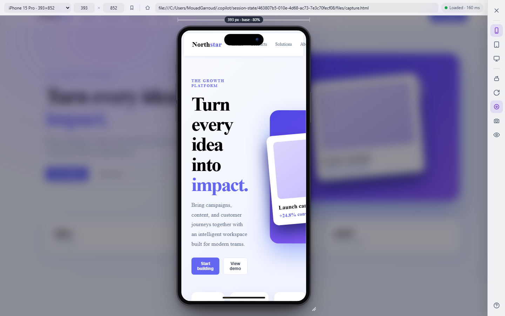

# ResponsiveSnap

**Test responsive designs instantly with a realistic device mockup injected into the current tab.**

[](LICENSE)
[](CHANGELOG.md)
[](manifest.json)
[](content.js)
[](https://github.com/M003aad/ResponsiveSnap/actions/workflows/ci.yml)

## Table of Contents

- [Overview and Architecture](#overview-and-architecture)
- [Features](#features)
- [Screenshots](#screenshots)
- [Codebase Breakdown](#codebase-breakdown)
- [Permissions](#permissions)
- [Installation and Setup](#installation-and-setup)
- [Usage](#usage)
- [Messaging and API Reference](#messaging-and-api-reference)
- [Scripts](#scripts)
- [Keyboard Shortcuts](#keyboard-shortcuts)
- [Contributing](#contributing)
- [Security](#security)
- [License](#license)

## Overview and Architecture

ResponsiveSnap is a Manifest V3 browser extension for Chromium-based browsers. Vanilla JavaScript builds an overlay in the active page, creates a preview iframe, and wraps it in a realistic mobile, tablet, or desktop frame. There is no popup, framework, bundler, or backend.

- `background.js` is the service worker. It handles toolbar clicks, injects the content files after extension reloads, tracks preview iframe navigation, and captures the visible tab.
- `content.js` builds the overlay and tools, loads persisted settings, exchanges messages, applies touch simulation, and exports screenshots.
- `content.css` namespaces the complete UI beneath `#responsivesnap-root`.
- `manifest.json` declares content scripts, permissions, the action, service worker, and Declarative Net Request rule.
- `rules.json` removes `X-Frame-Options` and `Content-Security-Policy` response headers from top-level and iframe responses so supported pages can render inside the preview.

## Features

- Toolbar toggle with automatic recovery when the extension is reloaded on an already-open tab.
- Twelve presets: iPhone 15 Pro, iPhone 15 Pro Max, Pixel 8, Galaxy S23, small phone, iPad mini, iPad Air, iPad Pro 12.9-inch, fluid desktop, laptop, Desktop HD, and Full HD.
- Up to 20 saved custom presets, stored locally.
- Portrait and landscape orientation, custom 200–4000 px dimensions, and a live resize grip.
- Responsive ruler showing viewport width and display scale.
- Tailwind or Bootstrap breakpoint markers, with the active breakpoint displayed beside the width.
- Current URL bar with path navigation, home, reload, and cross-tab navigation.
- Loading, loaded, slow, and failed states, including identifiable network, DNS, certificate, and iframe-blocking failures.
- Touch cursor, touch-event simulation, and drag scrolling for same-origin preview pages.
- Screen-only and complete-device PNG screenshots.
- Vision filters for protanopia, deuteranopia, tritanopia, achromatopsia, low contrast, and blur.
- Local image design overlay with opacity, Y offset, and difference blend controls.
- Persistent device, dimensions, orientation, touch, breakpoint-set, and vision settings.
- Keyboard shortcuts and a built-in help panel.

## Screenshots



## Codebase Breakdown

```text
ResponsiveSnap/
├── .github/
│   ├── ISSUE_TEMPLATE/
│   │   ├── bug_report.md
│   │   └── feature_request.md
│   ├── PULL_REQUEST_TEMPLATE.md
│   └── workflows/
│       ├── ci.yml
│       └── release.yml
├── docs/
│   └── screenshots/
│       └── responsivesnap-preview.png
├── icons/
│   ├── 16_16.png
│   ├── 32_32.png
│   ├── 48_48.png
│   └── 128_128.png
├── scripts/
│   ├── build-extension.js
│   └── check-extension.js
├── _metadata/
│   └── generated_indexed_rulesets/
│       └── _ruleset1
├── background.js
├── content.css
├── content.js
├── manifest.json
├── rules.json
├── package.json
├── eslint.config.js
├── CHANGELOG.md
├── CONTRIBUTING.md
├── SECURITY.md
├── SUPPORT.md
├── CODE_OF_CONDUCT.md
├── CITATION.cff
├── LICENSE
└── README.md
```

| Path                                             | Purpose                                                                                                                                         |
| ------------------------------------------------ | ----------------------------------------------------------------------------------------------------------------------------------------------- |
| `background.js`                                  | Manifest V3 service worker for toolbar toggling, recovery injection, iframe navigation tracking, storage-backed session state, and screenshots. |
| `content.js`                                     | Overlay, device controls, presets, persistence, navigation, touch handling, filters, overlays, and export behavior.                             |
| `content.css`                                    | Namespaced ResponsiveSnap UI styles and animations.                                                                                             |
| `manifest.json`                                  | Extension metadata, permissions, content scripts, action, service worker, and rule resource declaration.                                        |
| `rules.json`                                     | Declarative Net Request header changes used by the preview iframe.                                                                              |
| `docs/screenshots/`                              | README screenshot assets.                                                                                                                       |
| `icons/`                                         | Toolbar and extension icons.                                                                                                                    |
| `scripts/`                                       | Manifest validation and ZIP packaging commands.                                                                                                 |
| `_metadata/generated_indexed_rulesets/_ruleset1` | Browser-generated Declarative Net Request rule metadata; not application source.                                                                |
| `.github/`                                       | Issue templates, pull request template, CI, and release automation.                                                                             |
| `package.json`                                   | Development tool versions and validation/packaging scripts.                                                                                     |

## Permissions

| Permission                            | Reason                                                                                                             |
| ------------------------------------- | ------------------------------------------------------------------------------------------------------------------ |
| `declarativeNetRequest`               | Applies the bundled rule that removes response headers which block iframe embedding.                               |
| `declarativeNetRequestWithHostAccess` | Allows the rule to match both top-level and iframe requests under the declared host access.                        |
| `storage`                             | Persists preview state, saved presets, and active iframe-watch metadata.                                           |
| `scripting`                           | Re-injects `content.js` and `content.css` after a toolbar click on a tab opened before the extension was reloaded. |
| `webNavigation`                       | Tracks preview iframe loading and errors, including cross-origin navigations.                                      |
| `<all_urls>`                          | Injects the preview UI and loads the selected page in an iframe on supported web pages.                            |

The `rules.json` rule removes `X-Frame-Options` and `Content-Security-Policy` from main-frame and sub-frame responses. This permits embedding, but cannot bypass every application, certificate, authentication, or browser protection. Review and use the extension only on pages you are authorized to test.

## Installation and Setup

### Chrome or Edge

1. Install Git and Node.js 20 or newer.
2. Clone the repository:

   ```sh
   git clone https://github.com/M003aad/ResponsiveSnap.git
   cd ResponsiveSnap
   ```

3. Install development tools:

   ```sh
   npm install
   ```

4. Open `chrome://extensions/` in Chrome or `edge://extensions/` in Edge.
5. Enable **Developer mode**.
6. Choose **Load unpacked** and select the repository folder.
7. Open a regular `http://` or `https://` page and click the ResponsiveSnap toolbar icon.

The manifest requires Chrome 105 or newer. Firefox is not supported by the existing Manifest V3 implementation because the code uses Chromium WebExtension APIs and packaging conventions.

After editing source files, reload the extension in the extensions page and refresh the target tab. No environment variables are required.

### Build a Package

```sh
npm run check
npm run build
```

The ZIP is created at `dist/responsivesnap.zip`. `dist/` is ignored and is not the source code.

## Usage

1. Click the ResponsiveSnap toolbar icon to open or close the overlay.
2. Select a device category or a preset from the sidebar.
3. Switch orientation with the rotate control, or enter custom width and height values.
4. Drag the lower-right frame grip to resize, and use the ruler to inspect the viewport size and active breakpoint.
5. Enter a URL or path in the address bar. Use Home to return to the original tab URL and Reload to retry the preview.
6. Toggle touch simulation, then interact with same-origin pages using mouse/touch-style behavior.
7. Open **View tools** to select breakpoints, vision filters, or a design overlay image.
8. Save a custom size, or select a previously saved preset from the saved section.
9. Capture a PNG with `S` for the screen or `Shift+S` for the complete frame.
10. Close the preview with the close control or `Esc`.

A red `!` badge means Chrome blocked the extension on the current page, such as a protected `chrome://` page or the Chrome Web Store. Cross-origin iframe pages limit same-origin touch behavior and keyboard forwarding because the host browser isolates their documents.

## Messaging and API Reference

ResponsiveSnap uses internal `chrome.runtime` messages and `chrome.tabs.sendMessage`; it does not call an external API or backend.

| Message                 | Direction            | Payload                        | Response                                           |
| ----------------------- | -------------------- | ------------------------------ | -------------------------------------------------- |
| `RESPONSIVESNAP_TOGGLE` | Background → content | `{ type }`                     | `undefined`                                        |
| `RESPONSIVESNAP_FRAME`  | Background → content | `{ type, phase, url, error? }` | `undefined`                                        |
| `RS_WATCH`              | Content → background | `{ type, url }`                | `{ ok: true }`                                     |
| `RS_UNWATCH`            | Content → background | `{ type }`                     | `{ ok: true }`                                     |
| `RS_CAPTURE`            | Content → background | `{ type }`                     | `{ ok: true, dataUrl }`, or `{ ok: false, error }` |

Example request:

```json
{
  "type": "RS_WATCH",
  "url": "https://example.com/"
}
```

Navigation phase values are `loading`, `done`, and `error`. The background worker maps watched preview frames to the tab and forwards only that frame's navigation events to the top-level content script.

## Scripts

| Script       | Command                | Purpose                                                                                                                 |
| ------------ | ---------------------- | ----------------------------------------------------------------------------------------------------------------------- |
| Lint         | `npm run lint`         | Lint `background.js` and `content.js` with ESLint flat configuration.                                                   |
| Format check | `npm run format:check` | Check supported source/config/documentation formatting with Prettier.                                                   |
| Validate     | `npm run check`        | Parse `manifest.json`, verify referenced files exist, enforce Manifest V3, and confirm package/manifest versions match. |
| Build        | `npm run build`        | Validate and package the loadable extension files into `dist/responsivesnap.zip`.                                       |

## Keyboard Shortcuts

| Key                                   | Action                             |
| ------------------------------------- | ---------------------------------- |
| `Esc`                                 | Close the preview or an open panel |
| `R`                                   | Reload                             |
| `O`                                   | Rotate                             |
| `[` / `]` or `Alt+Left` / `Alt+Right` | Previous or next device            |
| `T`                                   | Toggle touch simulation            |
| `S`                                   | Capture the preview screen         |
| `Shift+S`                             | Capture the complete device frame  |
| `L` or `/`                            | Focus the URL bar                  |
| `V`                                   | Open view tools                    |
| `?`                                   | Open help                          |

Shortcuts are active while focus is in the overlay or same-origin preview. They are ignored while typing in a field.

## Contributing

Please read [CONTRIBUTING.md](CONTRIBUTING.md) before reporting bugs, proposing features, or submitting a pull request.

## Security

See [SECURITY.md](SECURITY.md) for supported versions and private vulnerability reporting.

## License

ResponsiveSnap is licensed under the [GNU Affero General Public License v3.0](LICENSE). Copyright is held by M003aad.
